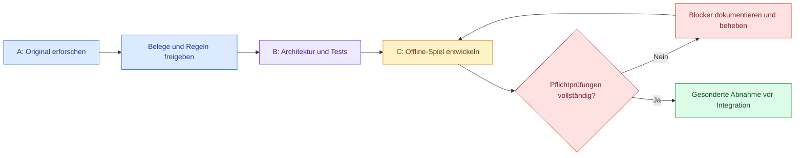

# OLI IMPERIUM | C64-Forschung, Architektur & Spielentwicklung


**Repository:** [provoware/PROJEKT_Oli_Imperium](https://github.com/provoware/PROJEKT_Oli_Imperium)  
**Dokumentationsstand:** 31.10.2026 · **Version:** 3.1 · **Hauptzweig:** `main`  
**Wissenschaftlicher Status:** Originalreferenz noch nicht verifiziert · **Spielstatus:** technische Entwicklung auf getrennten Entwurfszweigen, keine Gesamtfreigabe.

> [!IMPORTANT]
> **Forschung, Umsetzung und Freigabe sind drei verschiedene Dinge.** Projekt C wird bereits technisch entwickelt und getestet, ist aber **nicht freigegeben oder in `main` integriert**. Ein historisch originalgetreuer 1:1-Nachbau ist ohne überprüfte C64-Referenz nicht belegt. Grüne Einzeltests bedeuten keine abgeschlossene Gesamtprüfung.

## 🧭 Wegweiser

| Bereich | Aufgabe | Nachweis / Einstieg |
|---|---|---|
| 🔵 **Arbeit A – Forschung** | Originalversion, Menüs, Regeln und Belege erforschen | [Forschungsplan](docs/01_FORSCHUNG_A.md) · [Quellenstatus](docs/04_ORIGINAL_QUELLEN.md) |
| 🟣 **Arbeit B – Technik** | Quellenbasierte Datenmodelle, Architektur und Prüfverfahren | [Architektur](docs/02_ARCHITEKTUR_B.md) · [Übergabe A→B](docs/03_UEBERGABE_A_B.md) |
| 🟠 **Projekt C – Umsetzung** | Eigenständiger Offline-HTML-Spielzweig; technische Entwürfe und Tests | [Integrationsentwurf #141](https://github.com/provoware/PROJEKT_Oli_Imperium/pull/141) |
| 🔴 **Freigabe & Risiken** | Offene Pflichtkriterien, Originalnachweise und Rechte vor Veröffentlichung klären | [Prüfregeln](docs/05_TESTS_FORTSCHRITT.md) · [Risiken](docs/07_RISIKEN_RECHTE.md) |
| 🛠️ **Änderungen** | Vorschläge prüfen, Entwurfsketten auflösen, nur Freigegebenes integrieren | [Offene PRs](https://github.com/provoware/PROJEKT_Oli_Imperium/pulls?q=is%3Aopen) · [PR-Abbau #138](https://github.com/provoware/PROJEKT_Oli_Imperium/issues/138) |

> [!WARNING]
> **Prüfstand vom 31.10.2026, kein Live-Zähler:** 52 Pflichtkriterien → **6 bestanden · 39 blockiert · 4 offen · 3 zurückgestellt**. Dazu 73 offene PR-Entwürfe bei der Bestandsaufnahme. Maßgeblich sind immer die aktuellen [PRs](https://github.com/provoware/PROJEKT_Oli_Imperium/pulls?q=is%3Aopen), [Prüfnachweise](https://github.com/provoware/PROJEKT_Oli_Imperium/actions) und die zugehörige Pflichtmatrix im Projekt-C-Entwicklungszweig. Die Daten sind ausdrücklich **keine Releasefreigabe**.

## 🎨 Projektablauf



## Zweck
Zwei eigenständige, wissenschaftliche Abschlussarbeiten mit gemeinsamer, versionierter Materialbasis:
- **Arbeit A – Spielkonzeption und C64-Forschung:** Was ist im Original *Oil Imperium* (1989) tatsächlich nachweisbar? Quellen, Bildschirmatlas, Menüwege, Wirtschaft, Minispiele, zeitliche Abläufe und Grenzfälle.
- **Arbeit B – Softwarekonzeption und Entwicklungsplanung:** Wie werden die von A freigegebenen Funktionen in eine reproduzierbare, wartbare und prüfbare Architektur übersetzt? Arbeit B enthält eigenständige technische Begründungen.
- **Eigenständiges Projekt C – Umsetzung (aktuell Entwurfsphase):** Offline-HTML-Spielentwicklung wird auf gesonderten Zweigen geprüft; keine vorgezogene Integration oder Veröffentlichung. Eine Deutschland-/PPPOPPI-Adaption bleibt ein klar getrennter Ableger.

**Verbindlicher Grundsatz:** Das Original bestimmt die Fachregeln. Eine plausible Modellierung ist keine belegte historische Implementierung. Kein behaupteter 1:1-Nachbau ohne Originalvergleich.

## Sofortiger Einstieg
1. [Projektcharta / Forschungsfragen](docs/00_PROJEKTCHARTA.md) lesen.
2. [Roadmap und Abnahmeprüfungen](docs/08_ROADMAP_CHECKPOINTS.md) ansehen.
3. Fachfragen als [Regelkarte](vorlagen/REGELKARTE.md), technische Fragen als [Modulkarte](vorlagen/MODULKARTE.md) erfassen.
4. [Übergabevertrag A→B](docs/03_UEBERGABE_A_B.md) beachten; offene Angaben nicht erfinden.
5. [Qualitäts- und Fortschrittsprüfung](docs/05_TESTS_FORTSCHRITT.md) ausführen: `python3 tools/validate_project.py`.
6. Zum Schluss [Handzettel](docs/09_HANDZETTEL.md) als Kurzüberblick verwenden.

## Projektweg
`Quelle → Beobachtung → Regel-ID → Freigabe → Modul-ID → Prüf-ID → Architekturentscheidung → Entwicklungsfreigabe`

**Parallelität:** B kann unabhängige Strukturen entwickeln, sobald A einzelne vollständige Fachpakete freigibt. Offene Punkte sperren nur betroffene Funktionen.

## Inhaltsverzeichnis
- [A: Historische Erforschung](docs/01_FORSCHUNG_A.md)
- [B: Architektur und technische Planung](docs/02_ARCHITEKTUR_B.md)
- [Gegenseitige Übergaben und Fragen](docs/03_UEBERGABE_A_B.md)
- [Quellen, Originalversion und Evidenz](docs/04_ORIGINAL_QUELLEN.md)
- [Tests, Kennzahlen und Fortschritt](docs/05_TESTS_FORTSCHRITT.md)
- [Screenshot-Verfahren und Bildrechte](docs/06_BILDER_PIPELINE.md)
- [Risiken, Recht und Datenhygiene](docs/07_RISIKEN_RECHTE.md)
- [Roadmap, Meilensteine und Definitionen von fertig](docs/08_ROADMAP_CHECKPOINTS.md)
- [Handzettel / Spickzettel](docs/09_HANDZETTEL.md)
- [Glossar und Sachindex](docs/10_GLOSSAR_INDEX.md)
- [Vortrag und Heimstudie](docs/11_VORTRAG_STUDIE.md)
- [Spätere Deutschland-/PPPOPPI-Adaption](docs/12_ADAPTION.md)
- [Maschinenlesbarer Datenbestand](data/README.md)
- [Änderungsprozess](CONTRIBUTING.md) und [Codex-Regeln](AGENTS.md)

## Aktuell verifizierbarer Stand
| Nachweis | Stand |
|---|---|
| Repository und Grundstruktur | mit dieser Änderung angelegt |
| C64-PAL-Referenz mit SHA-256 und nachgewiesenem Emulatorlauf | offen |
| Vollständiges Regelinventar | offen |
| Historische Screenshotserie aus eigener Originalausführung | offen |
| Formelle A→B-Übergabe | offen |
| Projekt C: Offline-HTML-Implementierung | auf Entwicklungszweigen vorhanden; auf `main` nicht freigegeben |
| Originaltreue-Prozentwert | nicht messbar ohne verifizierte Testbasis |

**Wichtig:** Das Repository ist öffentlich. Urheberrechtlich geschützte Original-Diskettenabbilder, Codesheets, Scans, Musik und unfreigegebene Hochschulunterlagen nicht einchecken.

## ✅ Lokale Basisprüfungen

```bash
python3 tools/validate_project.py
python3 -m unittest discover -s tests -v
```

> [!TIP]
> Reine README-Änderungen benötigen zusätzlich eine Prüfung der Markdown-Links, nicht jedoch einen unbelegten C64-Originaltest. Vor dem Zusammenführen gehören die Prüfungen auf den **tatsächlich geänderten Commit**.

## Erste drei Schritte
1. Hochschulvorgaben und getrennte wissenschaftliche Eigenleistungen abstimmen.
2. Konkrete deutsche C64-PAL-Referenz bestimmen, Provenienz, Hash und Emulatorprotokoll dokumentieren.
3. Einen vollständigen Ablauf `Büro → Weltkarte → Feldinformation → Rückweg` als Pilot erforschen und A→B übergeben.
